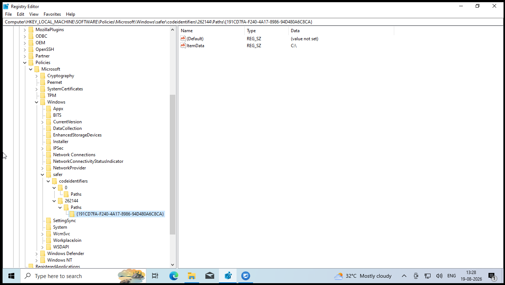
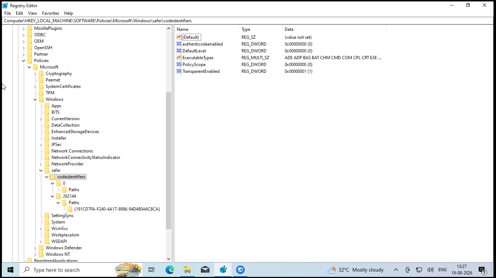

# Windows 10 Home -- Software Restriction Policy (Registry-Based) All Kind of software including MSI, EXE Etc.

# 1. Purpose

This document records the **Registry-only Software Restriction Policy
(SRP)** configuration applied on a Windows 10 Home system.

## Sample Image after completing the setup





## Objective

The configured behavior is:

-   `C:\` is treated as an **Unrestricted** location.
-   Executable software from other locations/drives is **Disallowed by
    default**.
-   The policy applies to the local Administrator account as well.
-   Common executable/installer file types are included in the SRP
    `ExecutableTypes` list.
-   The configuration was tested successfully:
    -   An executable from `C:\` ran normally.
    -   A copy of the executable from another drive was blocked.

> **Important:** This is a practical restriction, not a tamper-proof
> security boundary. A sufficiently knowledgeable Administrator can
> potentially modify or remove local policy/registry settings. Microsoft
> also notes that SRP is deprecated beginning with Windows 10 build 1803
> and recommends newer application-control technologies for supported
> editions. This document records the configuration that was actually
> implemented and tested on this Windows 10 Home machine.

------------------------------------------------------------------------

# 2. Registry Location

The main SRP registry location is:

``` text
HKEY_LOCAL_MACHINE\SOFTWARE\Policies\Microsoft\Windows\Safer\CodeIdentifiers
```

The configuration uses the following structure:

``` text
HKEY_LOCAL_MACHINE
└── SOFTWARE
    └── Policies
        └── Microsoft
            └── Windows
                └── Safer
                    └── CodeIdentifiers
                        ├── 0
                        │   └── Paths
                        │
                        └── 262144
                            └── Paths
                                └── {191CD7FA-F240-4A17-8986-94D480A6C8CA}
```

The `0` branch was created as part of the SRP structure but no path rule
was added under `0\Paths`.

The active allow rule is under the `262144` branch.

------------------------------------------------------------------------

# 3. Create the Registry Keys

## Step 1 -- Open Registry Editor

Press:

``` text
Win + R
```

Type:

``` text
regedit
```

Press **Enter**.

Approve the UAC prompt if displayed.

------------------------------------------------------------------------

## Step 2 -- Navigate to the SRP location

Go to:

``` text
HKEY_LOCAL_MACHINE\SOFTWARE\Policies\Microsoft\Windows
```

Under `Windows`, locate:

``` text
Safer
```

Then:

``` text
Safer\CodeIdentifiers
```

In this configuration, `CodeIdentifiers` was already present.

Full path:

``` text
HKEY_LOCAL_MACHINE\SOFTWARE\Policies\Microsoft\Windows\Safer\CodeIdentifiers
```

------------------------------------------------------------------------

# 4. Create the `0` Subkey

Inside:

``` text
CodeIdentifiers
```

Create a new Registry Key:

``` text
0
```

Then inside `0`, create another Registry Key:

``` text
Paths
```

Result:

``` text
CodeIdentifiers
└── 0
    └── Paths
```

No path rule was added under this branch.

------------------------------------------------------------------------

# 5. Create the `262144` Subkey

Inside:

``` text
CodeIdentifiers
```

create another Registry Key:

``` text
262144
```

Inside `262144`, create:

``` text
Paths
```

Result:

``` text
CodeIdentifiers
└── 262144
    └── Paths
```

------------------------------------------------------------------------

# 6. Create the Unrestricted `C:\` Path Rule

Navigate to:

``` text
HKEY_LOCAL_MACHINE\SOFTWARE\Policies\Microsoft\Windows\Safer\CodeIdentifiers\262144\Paths
```

Create a new Registry Key with this exact name:

``` text
{191CD7FA-F240-4A17-8986-94D480A6C8CA}
```

Inside that GUID key, create a:

``` text
String Value (REG_SZ)
```

Name:

``` text
ItemData
```

Set its value to:

``` text
C:\
```

Final structure:

``` text
CodeIdentifiers
└── 262144
    └── Paths
        └── {191CD7FA-F240-4A17-8986-94D480A6C8CA}
            └── ItemData    REG_SZ    C:\
```

### Result

This makes `C:\` the explicitly allowed/unrestricted path exception
while the default SRP level remains Disallowed.

Microsoft documents the SRP model where a default **Disallowed** level
can be combined with specific **Unrestricted** path rules. It also warns
that incorrectly restricting critical Windows directories can affect
operating-system operation. In this configuration, `C:\` was
intentionally allowed for that reason.

------------------------------------------------------------------------

# 7. Configure `CodeIdentifiers` Values

Select:

``` text
HKEY_LOCAL_MACHINE\SOFTWARE\Policies\Microsoft\Windows\Safer\CodeIdentifiers
```

The following values were configured.

## 7.1 `DefaultLevel`

Type:

``` text
REG_DWORD 32 Bit Value
```

Name:

``` text
DefaultLevel
```

Value:

``` text
0
```

Base:

``` text
Decimal
```

Meaning:

``` text
0 = Disallowed
```

This establishes the default SRP behavior as **Disallowed**.

------------------------------------------------------------------------

## 7.2 `TransparentEnabled`

Type:

``` text
REG_DWORD 32 Bit Value
```

Name:

``` text
TransparentEnabled
```

Value:

``` text
1
```

Base:

``` text
Decimal
```

This enables the SRP enforcement mode used in this configuration.

------------------------------------------------------------------------

## 7.3 `PolicyScope`

Type:

``` text
REG_DWORD 32 Bit Value
```

Name:

``` text
PolicyScope
```

Value:

``` text
0
```

Base:

``` text
Decimal
```

This configuration keeps the policy applicable to the Administrator
account rather than excluding local administrators.

------------------------------------------------------------------------

## 7.4 `authenticodenabled`

Type:

``` text
REG_DWORD 32 Bit Value
```

Name:

``` text
authenticodenabled
```

Value:

``` text
0
```

Base:

``` text
Decimal
```

Certificate-based SRP rules were not enabled in this configuration.

------------------------------------------------------------------------

# 8. Configure `ExecutableTypes`

Inside:

``` text
CodeIdentifiers
```

create:

``` text
ExecutableTypes
```

Type:

``` text
REG_MULTI_SZ Multi String Value
```

**Important:** It must be a **Multi-String Value**, not a normal
`REG_SZ` String Value.

The following entries were configured, with each item on a separate
line:

``` text
ADE
ADP
BAS
BAT
CHM
CMD
COM
CPL
CRT
EXE
HLP
HTA
INF
INS
ISP
LNK
MDB
MDE
MSC
MSI
MSP
MST
OCX
PCD
PIF
REG
SCR
SHS
URL
VB
VBE
VBS
WSC
```

The Registry Editor should show:

``` text
ExecutableTypes    REG_MULTI_SZ
```

The extensions are entered **without the dot**.

Correct:

``` text
EXE
MSI
CMD
BAT
```

Not:

``` text
.exe
.msi
.cmd
.bat
```

Microsoft notes that SRP path rules affect only file types included in
the designated file-type list.

------------------------------------------------------------------------

# 9. Final `CodeIdentifiers` Configuration

The final values under:

``` text
HKEY_LOCAL_MACHINE\SOFTWARE\Policies\Microsoft\Windows\Safer\CodeIdentifiers
```

are:

  Name                    Type                      Value Base
  ----------------------- -------------- ---------------- ---------
  `authenticodenabled`   REG_DWORD                   `0` Decimal
  `DefaultLevel`          REG_DWORD                   `0` Decimal
  `TransparentEnabled`    REG_DWORD                   `1` Decimal
  `PolicyScope`           REG_DWORD                   `0` Decimal
  `ExecutableTypes`       REG_MULTI_SZ     See list above N/A

The path-rule branch is:

``` text
CodeIdentifiers
└── 262144
    └── Paths
        └── {191CD7FA-F240-4A17-8986-94D480A6C8CA}
            └── ItemData = C:\
```

------------------------------------------------------------------------

# 10. Complete Registry Tree

For reference, the complete configuration created during this setup is:

``` text
HKEY_LOCAL_MACHINE
└── SOFTWARE
    └── Policies
        └── Microsoft
            └── Windows
                └── Safer
                    └── CodeIdentifiers
                        │
                        ├── authenticodenabled    REG_DWORD    0
                        ├── DefaultLevel           REG_DWORD    0
                        ├── TransparentEnabled     REG_DWORD    1
                        ├── PolicyScope            REG_DWORD    0
                        ├── ExecutableTypes        REG_MULTI_SZ
                        │
                        ├── 0
                        │   └── Paths
                        │
                        └── 262144
                            └── Paths
                                └── {191CD7FA-F240-4A17-8986-94D480A6C8CA}
                                    └── ItemData    REG_SZ    C:\
```

------------------------------------------------------------------------

# 11. How the Configuration Works

The policy follows this basic model:

``` text
Default SRP level
        │
        ▼
   Disallowed
        │
        ├── C:\  → Explicit Unrestricted rule
        │
        └── Other locations → Disallowed by default
```

Therefore:

  Location                                    Expected behavior
  ------------------------------------------- -----------------------------------------
  `C:\`                                       Allowed
  `D:\`                                       Blocked for designated executable types
  `E:\`                                       Blocked for designated executable types
  Other local drives                          Blocked for designated executable types
  Removable drives                            Blocked for designated executable types
  Portable EXE on non-C drive                 Blocked
  Installer EXE on non-C drive                Blocked
  Existing application installed under C:\\   Allowed

The exact behavior depends on the executable type being included in
`ExecutableTypes` and on the applicable SRP rule precedence.

------------------------------------------------------------------------

# 12. Testing Procedure

After applying the policy, test with a harmless Windows executable.

## Test 1 -- Run from C: 

Use:

``` text
C:\Windows\System32\notepad.exe
```

Expected:

``` text
Runs normally
```

This confirms that the `C:\` Unrestricted path rule is working.

------------------------------------------------------------------------

## Test 2 -- Copy the same executable to another drive

For example:

``` text
D:\Test\notepad.exe
```

Try to run it.

Expected:

``` text
Execution is blocked by Software Restriction Policy.
```

This confirms that the default Disallowed rule is being applied outside
the explicitly allowed path.

------------------------------------------------------------------------

# 13. Backup / Recovery

Before modifying the policy in the future, export:

``` text
HKEY_LOCAL_MACHINE\SOFTWARE\Policies\Microsoft\Windows\Safer
```

In Registry Editor:

1.  Right-click `Safer`.
2.  Select **Export**.
3.  Save the backup as, for example:

``` text
SRP-Safer-Backup.reg
```

To restore the configuration later, double-click the backup `.reg` file
and restart/log off as appropriate.

------------------------------------------------------------------------

# 14. Important Maintenance Notes

## Do not change `DefaultLevel` casually

Current value:

``` text
DefaultLevel = 0
```

This is the core of the restriction.

Changing it can change the overall allow/deny behavior.

------------------------------------------------------------------------

## Do not remove the `C:\` Unrestricted rule without testing

Windows and existing applications may rely on executables located under
`C:\`.

The current configuration intentionally allows `C:\` so that normal
Windows components and existing applications continue to operate.

------------------------------------------------------------------------

## Keep the Administrator account configuration in mind

The policy was deliberately configured with:

``` text
PolicyScope = 0
```

because the target user is using an Administrator account.

------------------------------------------------------------------------

## Test after major Windows/application changes

If a Windows update or existing application update changes where an
executable is stored, test the affected application.

If an application is moved outside an allowed path, SRP can block it.

Microsoft also notes that SRP is path-based for path rules, so moving
software can change whether a path rule applies.

------------------------------------------------------------------------

# 15. Limitations

This configuration is designed as a **practical workstation
restriction**.

It should not be considered a cryptographically secure or tamper-proof
application-control system.

A knowledgeable Administrator with sufficient access can potentially:

-   Modify the Registry.
-   Remove or alter SRP settings.
-   Change permissions.
-   Disable or alter related services/policies.
-   Restore the system from another administrative environment.

Microsoft recommends newer application-control technologies for modern
Windows environments because Software Restriction Policies were
deprecated beginning with Windows 10 version 1803.

For this particular Windows 10 Home deployment, however, the
Registry-based configuration above was **successfully applied and
tested**.

------------------------------------------------------------------------

# 16. Quick Reference

### Main key

``` text
HKEY_LOCAL_MACHINE\SOFTWARE\Policies\Microsoft\Windows\Safer\CodeIdentifiers
```

### Values

``` text
DefaultLevel = 0
TransparentEnabled = 1
PolicyScope = 0
authenticodenabled = 0
```

All four are:

``` text
REG_DWORD
Base: Decimal
```

### ExecutableTypes

``` text
REG_MULTI_SZ
```

### Allowed path

``` text
C:\
```

Stored as:

``` text
HKEY_LOCAL_MACHINE\SOFTWARE\Policies\Microsoft\Windows\Safer\CodeIdentifiers\262144\Paths\{191CD7FA-F240-4A17-8986-94D480A6C8CA}\ItemData
```

Type:

``` text
REG_SZ
```

Value:

``` text
C:\
```

### Final policy concept

``` text
C:\                 → ALLOWED
Other locations     → DISALLOWED by default
Administrator       → POLICY APPLIES
```

------------------------------------------------------------------------

# 17. Microsoft References

-   Software Restriction Policies -- Microsoft Learn:
    https://learn.microsoft.com/en-us/windows-server/identity/software-restriction-policies/software-restriction-policies

-   Work with Software Restriction Policies Rules -- Microsoft Learn:
    https://learn.microsoft.com/en-us/windows-server/identity/software-restriction-policies/work-with-software-restriction-policies-rules

-   Administer Software Restriction Policies -- Microsoft Learn:
    https://learn.microsoft.com/en-us/windows-server/identity/software-restriction-policies/administer-software-restriction-policies

-   Software Restriction Policies Technical Overview -- Microsoft Learn:
    https://learn.microsoft.com/en-us/windows-server/identity/software-restriction-policies/software-restriction-policies-technical-overview
